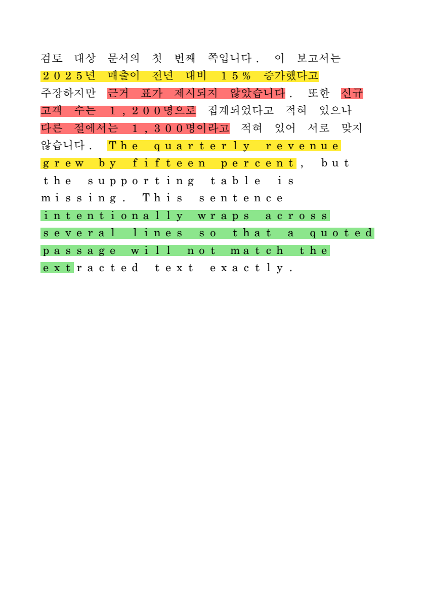
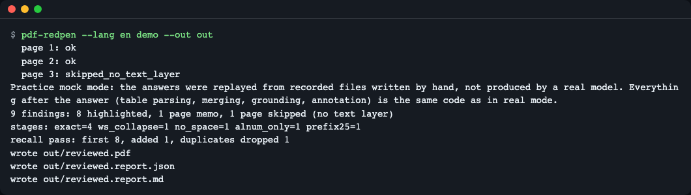
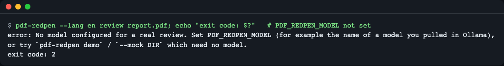
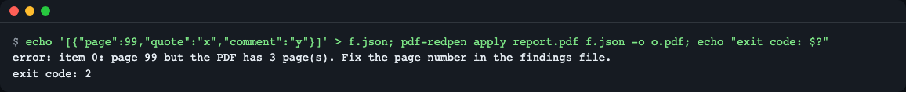
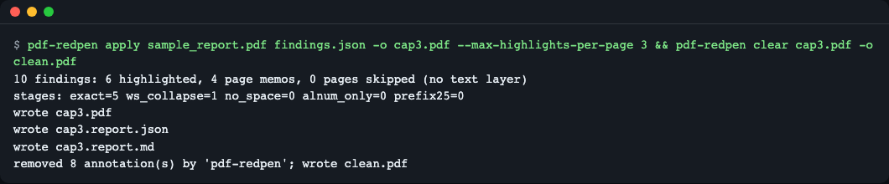
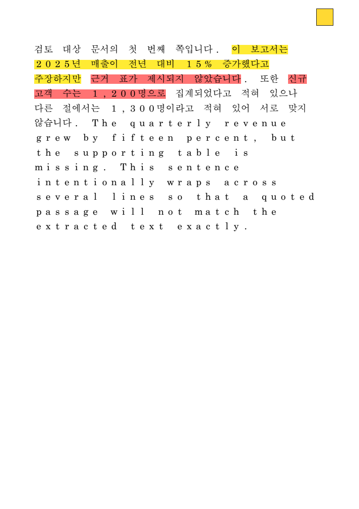
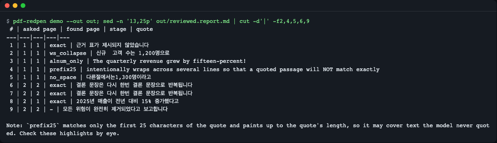
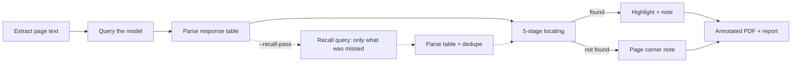
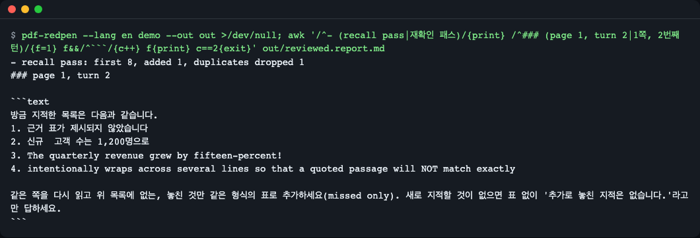

# pdf-redpen

[한국어](README.md) | **English**

pdf-redpen takes the sentences an LLM quoted while reviewing a PDF and finds them in the original file, even when the model changed spaces, punctuation or the page number. It then draws standard highlight + note annotations that open in any PDF viewer. Try it with no API key: `uv tool install git+https://github.com/LeeGyeongPil/pdf-redpen && pdf-redpen demo --out out` (the demo replays hand-written recorded answers, a practice mock). MIT license.

It is a CLI that turns an LLM review note like "this sentence somewhere on page 3" into a **highlighter mark and a sticky note at that exact spot** in the original PDF.


*A picture of page 1 of the `reviewed.pdf` made by `pdf-redpen demo`. Sentences that span several lines are painted line by line. (The image renderer draws the Korean font with a substitute typeface, so the letter spacing looks wide, but the painted positions follow the character coordinates exactly.)*

## Who it is for
- People who have an LLM do a first review of a report, proposal or paper PDF, and find it tedious to go back and forth between the list of remarks and the original to find sentences
- People who have run into the problem that a sentence the model quoted "does not show up in search" (spaces, word spacing or punctuation changed, wrong page number)
- Developers who want to show the findings JSON from other tools, such as spell or terminology checkers, on top of a PDF
- People who want to see in numbers how many more findings appear when the LLM is asked once more, "did you miss anything?"

## Why it is needed (a red-pen analogy)
If a proofreader writes only "something is off somewhere on page 3", you end up rereading page 3. If they **draw a highlighter line on the odd sentence and stick a note beside it**, you can fix it right away. An LLM is good at the earlier part (finding a sentence and talking about it), but it cannot copy the quoted sentence **identically down to the last character**. This tool handles the follow-up work of tying that "nearly identical sentence" to the real character positions in the PDF.

## Installation
```bash
# Prerequisite: uv (Python package manager). Skip if you already have it.
curl -LsSf https://astral.sh/uv/install.sh | sh
# Install the tool (Python 3.11 or later)
uv tool install git+https://github.com/LeeGyeongPil/pdf-redpen
```
You can also clone it and use it without installing: `git clone https://github.com/LeeGyeongPil/pdf-redpen && cd pdf-redpen && uv sync && uv run pdf-redpen --version`

On a minimal Linux (for example a slim container), `curl`, `git` and `ca-certificates` are needed. The PDF-processing dependencies (pdfplumber, pypdf, Pillow) are all installed as wheels, so no separate system libraries are needed.

## Quick start
No key or model is needed.

```bash
pdf-redpen demo --out out
```


*The `demo` run screen. Page 3 has no text layer, so the model is not called and the page is skipped.*

> **This is a practice mock mode.** The model's responses are replaced by recorded files bundled in the repository (`src/pdf_redpen/data/recorded/`, **written by hand by a person and not the real output of any particular model**). What happens after a response arrives (table parsing, recall merge, locating, writing annotations) is **the same code** as in the real mode. A real model will flag more or fewer items, and different ones. The real mode can be much slower because of the model calls.

How to read it:

| Output | Meaning |
|---|---|
| `9 findings` | 9 findings produced by the model (the recording) |
| `8 highlighted` | 8 were located in the PDF and highlighted |
| `1 page memo` | 1 could not be found in the body and was written into that page's corner memo |
| `1 page skipped` | Pages without a text layer (scans, blank pages) are skipped |
| `stages: exact=4 ...` | A tally of which stage's matching method found each finding |
| `recall pass: first 8, added 1, ...` | 8 in the first pass, 1 added by asking again for "only what was missed", 1 duplicate removed |

Open `out/reviewed.pdf` in any PDF viewer. A finding that was located becomes a highlight (`/Highlight`) and its explanation is in the highlight's note (`/Contents`), visible when you click or hover over the highlight. Findings that were not located are gathered under `[위치 못 찾음]` ("location not found") in a single note icon at the page corner.

## Usage

| Command | What it does | Example |
|---|---|---|
| `demo` | Reviews the 3 bundled sample pages with recorded responses | `pdf-redpen demo --out out` |
| `review` | Reviews a PDF with a model and produces an annotated PDF and a report | `pdf-redpen review a.pdf --recall-pass -o a.reviewed.pdf` |
| `apply` | Attaches a findings JSON to a PDF, without a model | `pdf-redpen apply a.pdf findings.json -o a.marked.pdf` |
| `clear` | Removes only the annotations this tool added | `pdf-redpen clear a.marked.pdf -o a.clean.pdf` |

`review` options: `--instructions FILE` (review guidelines), `--mock DIR` (replay recordings), `--record DIR` (save responses), `--recall-pass` (ask again for what was missed), `--max-highlights-per-page N` (default 20), `--pages 1-3,5`, `--author`, `--lang ko|en` (prompt language).
Exit codes:
- `0` Normal. It is 0 even if no findings were located (reported in the report), and if only some pages fail it prints `warning: N page(s) failed ...` to stderr and is still 0.
- `1` **All** pages sent to the model failed (`error: every page failed; ...`), or an unexpected error.
- `2` Input error (nonexistent file, bad JSON, out-of-range `page`, unknown `severity`, no model configured, etc.).

### Scenario 1. Review your own document with a local model
```bash
export PDF_REDPEN_BASE_URL=http://localhost:11434/v1   # OpenAI-compatible endpoint (e.g. Ollama)
export PDF_REDPEN_MODEL=<받아 둔 모델 이름>
pdf-redpen review report.pdf --instructions review.md --recall-pass --record rec -o report.reviewed.pdf
```
(`<받아 둔 모델 이름>` is a placeholder for "the name of the model you have pulled".)
- It extracts the text of each page and sends it to the model, then picks the quotations from the response table and locates them.
- With `--record rec`, the responses are saved to `rec/page{n}_turn{k}.md`, so later you can reproduce the same result with `--mock rec` without a key or network (for sharing with a team or regression checks). When you replay files you recorded yourself, the report still carries the "practice mock" notice, but the content is that model's response, not something a person wrote. `--mock` and `--record` cannot be used together (giving both is exit code 2).
- This mode **sends the page text to the endpoint you specify.** For sensitive documents, use a local model.

If the endpoint is not up or the model name is wrong, the cause is shown per page in the terminal. If all the pages sent fail, the exit code is 1.
```text
  page 1: error - LLMError: Could not reach http://127.0.0.1:9/v1/chat/completions (<urlopen error [Errno 61] Connection refused>). Is the server running? Local models can be slow; raise PDF_REDPEN_TIMEOUT (now 2s).
  ...
error: every page failed; see the causes above (or the Pages table in the report). Nothing was reviewed.
```

If you do not specify a model, it stops like this (exit code 2).


*An error screen shown on purpose. It tells you to set `PDF_REDPEN_MODEL` or use `demo` or `--mock`.*

### Scenario 2. Attach another tool's findings to a PDF (`apply`)
`findings.json` is an array like this (full example: [`examples/findings.json`](examples/findings.json)).
```json
[
  {"page": 1, "quote": "근거 표가 제시되지 않았습니다", "comment": "근거 표 추가 필요", "severity": "high"},
  {"page": 2, "quote": "존재하지 않는 문장입니다", "comment": "못 찾으면 페이지 메모로", "severity": "high"}
]
```
(In this sample, the first `quote` means "no supporting table is presented" and its `comment` is "supporting table needed"; the second `quote` is "a sentence that does not exist" and its `comment` is "if not found, as a page memo".)

`severity` is `high`, `medium` or `low` (colors: red, yellow, green) and may be omitted. Common aliases such as `critical`, `major` and `높음` ("high") are accepted, but unknown values (typos and the like) are rejected instead of silently becoming yellow.

If `page` exceeds the PDF's page count, **it stops with exit code 2 and does not create the output PDF**, so no finding disappears.


*An error screen shown on purpose. It tells you the item number (from 0) and the PDF's page count.*

An unknown `severity` is rejected with `error: f.json: item 0: unknown severity 'urgnt'; use high, medium or low (or omit 'severity').` (exit code 2).

### Scenario 3. A page with too many findings, and clearing to start over
The paths in this command (`src/...`, `examples/findings.json`) assume you run it in the folder where you cloned the repository. If you installed only with `pip` or `uv tool`, replace them with your own PDF and JSON paths.

```bash
pdf-redpen apply src/pdf_redpen/data/sample_report.pdf examples/findings.json -o cap3.pdf --max-highlights-per-page 3
pdf-redpen clear cap3.pdf -o clean.pdf
```


*Only up to 3 highlights are drawn on a page, and the rest are gathered into the page memo. `clear` removes only the 8 annotations whose author is `pdf-redpen` (6 highlights + 2 page memos, one per page).*


*Findings beyond the cap are gathered into a single yellow note icon at the top right as a `[상한 초과]` ("cap exceeded") list.*

`clear` removes only annotations whose `/T` (author) is `pdf-redpen`, so annotations added by people stay. If you attached them with a different author through `review --author name`, you must also give `pdf-redpen clear a.pdf -o b.pdf --author name` when clearing. Like `review`, `apply` also creates `<name>.report.json` and `<name>.report.md` next to the output PDF.

## Reading the report
`review` and `demo` create `<name>.report.json` (for machines) and `<name>.report.md` (for people) next to the output PDF (for example `out/reviewed.report.md`). Details not visible in the terminal are here.


*Part of the Findings table of `reviewed.report.md` (only the columns `#`, `asked page`, `found page`, `stage` and `quote` are shown, cropped). Finding 8 was said to be on page 2 but was found on page 1, and 9 is `-` (not found), so it went to the page memo.*

**Findings table columns**: `#` number / `source` (`turn1` = first query, `recall` = recall query, `apply` = JSON input) / `asked page` (the page the model said) / `found page` (the page actually found) / `stage` (which match stage, `-` if not found) / `status` / `severity` / `quote` / `comment`.

| Finding `status` | Meaning | What you see in the PDF |
|---|---|---|
| `highlighted` | Located and painted | Highlight + note |
| `memo_not_found` | Not found in the body | `[위치 못 찾음]` ("location not found") list in the page corner note |
| `memo_overflow` | Exceeded the per-page highlight cap (`--max-highlights-per-page`) | `[상한 초과]` ("cap exceeded") list in the page corner note |

**Pages table**: for each page, `status`, plus `first` (number of first-pass findings), `recall added`, `duplicates dropped`, `broken rows`, and `note`.

| Page `status` | Meaning |
|---|---|
| `ok` | Processed by calling the model |
| `skipped_no_text_layer` | No text layer, so the model was not called (the reason is in `note`) |
| `error` | The call for that page failed. The cause (for example `Could not reach ...`) is left in `note`, and the same cause also shows in the terminal |

If `note` contains `page text truncated before sending`, that page's text was cut at 12000 characters per page before going to the model, so findings in the latter part may be missing. Also, findings whose `stage` is `prefix25` may be painted longer than the quotation (see the 5-stage explanation below), so check them by eye.

## Configuration
Environment variables (needed only for the real `review`; not needed for `demo`, `apply`, `clear` or `review --mock`). Example: [`.env.example`](.env.example).

| Variable | Default | Description |
|---|---|---|
| `PDF_REDPEN_BASE_URL` | `http://localhost:11434/v1` | The front part of an OpenAI-compatible `chat/completions` endpoint |
| `PDF_REDPEN_MODEL` | (none, required) | Model name |
| `PDF_REDPEN_API_KEY` | (none) | If set, sent as `Authorization: Bearer`. Not recorded in code, reports or recording files |
| `PDF_REDPEN_TIMEOUT` | `120` | Seconds to wait for a response |

## How it works
There are two key parts: **locating (grounding)** and the **recall pass**.



1. **Extract text**: it flattens a page's text into one line of string, and for each character of the string remembers "the original character box number". The text sent to the model and the target being searched are the same string, so a copied sentence is always found. Pages without a text layer are skipped.
2. **Query**: for each page, the model is asked to answer in a "quoted original | finding | severity" table. Even if the table's header names or column order differ, or some rows are broken, it does not stop; it just counts each broken row and skips it.
3. **Recall query** (`--recall-pass`, the dotted line): after parsing the first-pass response table, it asks once more in the same conversation, "the list I just flagged is this, so add only what was missed." The point is to **show** the first-pass findings in the prompt, so only new findings are added rather than repeating the same things. The tables of the two responses are merged and duplicates are removed.
4. **5-stage locating**: it tries in order from strict to loose and uses the first stage that succeeds.
5. **Write annotations**: it makes a standard `/Highlight` with one rectangle (quad) per line, and also writes appearance information (`/AP`) so the highlight does not look different in each viewer. It saves to a temporary file (`.part`) page by page and replaces the whole, so even if it fails midway, the annotations of finished pages remain.

### 5-stage locating

| Stage | How it matches | Variation it catches |
|---|---|---|
| `exact` | The text as is | A normal quotation |
| `ws_collapse` | Runs of spaces and line breaks collapsed into one space | Double spaces, copied line breaks |
| `no_space` | All whitespace removed | Korean word-spacing errors |
| `alnum_only` | Compare letters and digits only | Punctuation and hyphen variations |
| `prefix25` | Match only the first 25 characters and paint to the quotation's length | Paraphrase of the latter part |

- If the same sentence appears twice, it avoids characters already painted and paints **the next occurrence** (findings 6 and 7 in the demo).
- If the model gets the page number wrong, it also looks in the neighboring pages (finding 8 in the demo: said page 2 but found on page 1).
- `prefix25` is the loosest, so it **can paint characters the model did not quote.** That is why it is the last resort, and the green tail ("ext") in the hero image above is an example. Check findings located at this stage by eye in the report.

For what the table columns mean, see "Reading the report" above.

### Why the recall pass is needed
**Recall** is "the share of the problems that actually exist that the model found". The recall of a single query can be low, to the point that asking the same model about the same document twice gives different numbers of findings. The **recall pass** is a further query to raise it: it keeps the first answer in the same conversation as an assistant message, shows the first-pass finding list again in the user message, and asks for **only what was missed** (implementation: `prompts.recall_turn`). The report lists the first-pass count and the added and de-duplicated counts separately. This technique **does not guarantee** a number of findings, and figures such as `added 1` in the demo are hand-written recorded values. Below is the recall prompt the demo actually sent.


*The prompt "the list I just flagged is as follows … add only what was missed (missed only)." and `recall pass: first 8, added 1, duplicates dropped 1`.*

### A tour of the code
- [`src/pdf_redpen/grounding.py`](src/pdf_redpen/grounding.py): 5-stage locating (`ground`) and neighboring-page search (`ground_finding`).
- [`src/pdf_redpen/recall.py`](src/pdf_redpen/recall.py) and [`prompts.py`](src/pdf_redpen/prompts.py): the recall query and merging.
- [`src/pdf_redpen/writer.py`](src/pdf_redpen/writer.py) and [`quads.py`](src/pdf_redpen/quads.py): annotations and quad coordinates (PDF puts the origin at the bottom left while extracted coordinates put it at the top left, so a conversion is needed).

### Using it from Python
The sample paths in the example below also assume you run it in the folder where you cloned the repository.

```python
from pdf_redpen import Finding, annotate_pdf

report = annotate_pdf(
    "src/pdf_redpen/data/sample_report.pdf",
    [Finding(1, "근거 표가 제시되지 않았습니다", "근거 표 추가 필요"),
     Finding(2, "존재하지 않는 문장입니다", "못 찾음")],
    "marked.pdf",
)
for p in report.placements:
    print(p.status, p.stage)   # highlighted exact / memo_not_found None
```

| Public name | Description |
|---|---|
| `annotate_pdf(src, findings, dst, *, max_per_page=20, author=...)` | Attaches a list of findings to a PDF, saves it to `dst` and returns a `Report` |
| `Finding(page, quote, comment, severity=None)` | One finding |
| `Report` | Tallies such as `placements` (`status` and `stage` per finding) and `pages` |
| `ground(page, quote, used)` | Low-level function: it needs an internal `PageText`, so you normally use only `annotate_pdf` |
| `Match`, `InputError` | The match result type, and the input error exception |

## Limits
- Scanned PDFs and PDFs with broken characters (`cid`) have no text layer and are skipped (no OCR).
- In two-column layouts the character reading order can get mixed up, so multi-line quotations may not be found.
- The look of highlights and notes can differ slightly between viewers.
- The real mode depends on the model's speed, and the page text is sent to the endpoint.

## When to use it
- This tool fits if you want to attach findings from an LLM or another tool to a standalone PDF file as annotations at the original's positions. Findings whose position could not be found are left as a page memo.
- If you handle several document formats or are in a .NET environment, look at [groupdocs ai-document-review-annotations-net](https://github.com/groupdocs-annotation/ai-document-review-annotations-net).
- If you manage paper annotations inside a Zotero library, look at [zotero-mcp](https://github.com/54yyyu/zotero-mcp).
- Other tools' features can change, so check the details yourself at each link. (The links were noted during the 2026-11-09 survey.)

## Troubleshooting
| Symptom | Cause | Fix |
|---|---|---|
| `error: No model configured ...` (exit code 2) | A real `review` without a model configured | Set `PDF_REDPEN_MODEL`, or use `demo` / `--mock DIR` |
| A page is shown as `skipped_no_text_layer` | A scan, a blank page, or broken character mapping | Use a PDF with a text layer (OCR is not supported) |
| A finding becomes `memo_not_found` | The model made up a sentence that is not in the body | Check the page corner note. If needed, use `--recall-pass` or strengthen the instructions |
| The painted range is longer than the quotation | It was found at the `prefix25` stage | Check the stage in the report and inspect by eye |
| Annotations overlap after running the same PDF again | The previous annotations remain | Run `pdf-redpen clear` first |

## Development and contributing
```bash
git clone https://github.com/LeeGyeongPil/pdf-redpen && cd pdf-redpen
uv sync
uv run pytest
```
Only the script that regenerates the sample PDF (`scripts/make_sample_pdf.py`) needs PyMuPDF (AGPL-3.0), and the package does not use it. Please leave bugs and suggestions as issues. Change history is in [CHANGELOG.md](CHANGELOG.md).

## Learn more
Checked 2026-11-09.
- pypdf, adding annotations: https://pypdf.readthedocs.io/en/stable/user/adding-pdf-annotations.html
- pdfplumber: https://github.com/jsvine/pdfplumber
- The concept of tying model quotations to document coordinates (grounding): https://artifex.com/blog/grounding-in-document-extraction
- Tools in the same family: https://github.com/neuml/annotateai, https://github.com/onekin/AnnotateGPT

## License
MIT. Direct dependencies: pdfplumber (MIT), pypdf (BSD-3-Clause), Pillow (MIT-CMU) (indirect dependencies such as pypdfium2 and cryptography are Apache-2.0/BSD family). For the sample PDF's fonts and sources, see [NOTICE.md](NOTICE.md).
