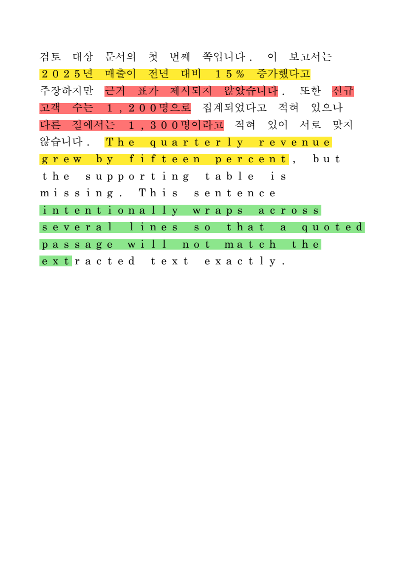
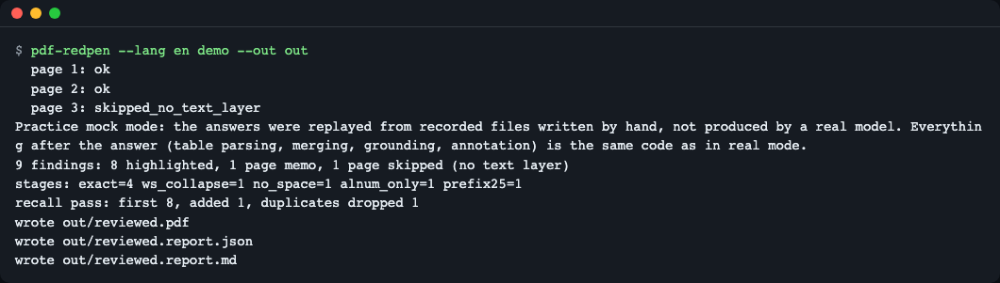
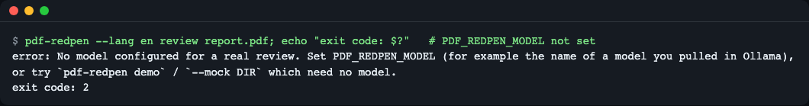
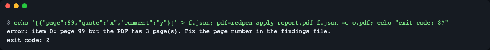
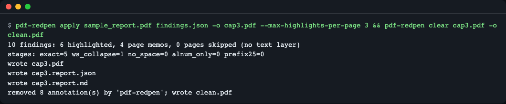
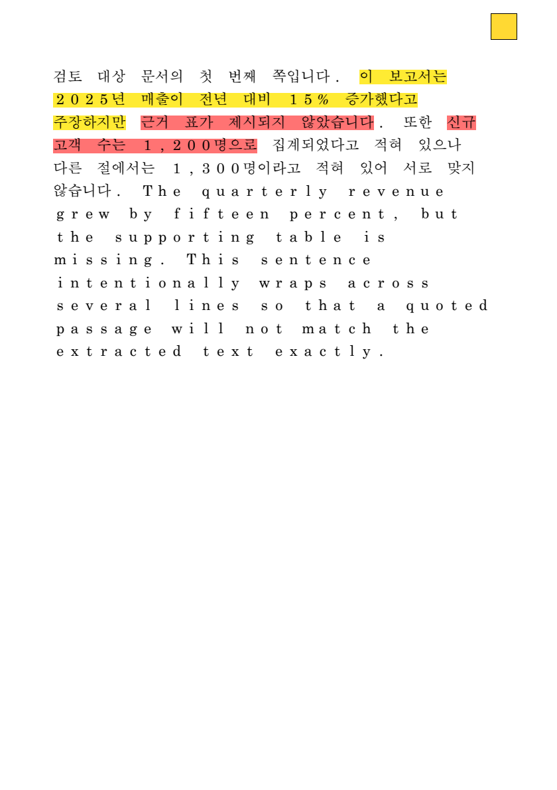
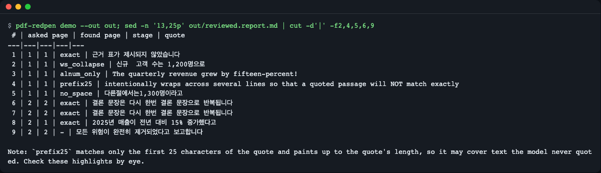
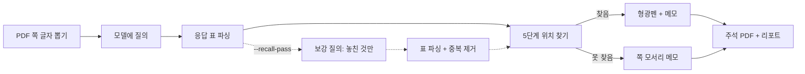
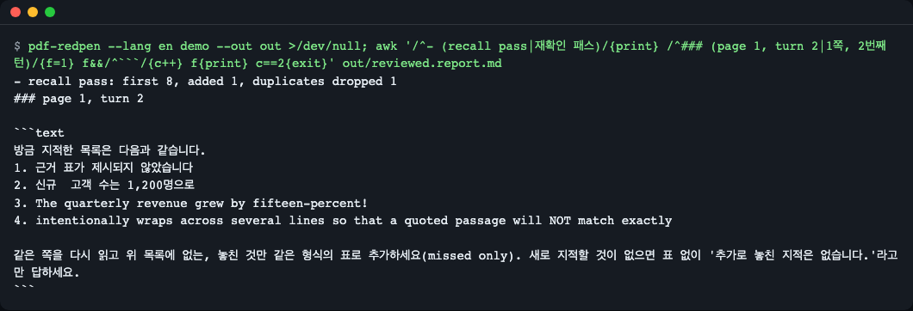

# pdf-redpen

> **English summary** — pdf-redpen takes the sentences an LLM quoted while reviewing a PDF and finds them in the original file, even when the model changed spaces, punctuation or the page number. It then draws standard highlight + note annotations that open in any PDF viewer. Try it with no API key: `uv tool install git+https://github.com/LeeGyeongPil/pdf-redpen && pdf-redpen demo --out out` (the demo replays hand-written recorded answers, a practice mock). MIT license.

LLM 검토 결과의 "3쪽 어딘가의 이 문장" 메모를, 원본 PDF의 **그 자리에 형광펜과 포스트잇**으로 달아 주는 CLI입니다.


*`pdf-redpen demo`가 만든 `reviewed.pdf`의 1쪽을 그린 그림. 여러 줄에 걸친 문장도 줄마다 칠해집니다. (그림 렌더러가 한글 폰트를 대체 글꼴로 그려 글자 간격이 넓어 보이지만, 칠한 위치는 글자 좌표 그대로입니다.)*

## 이런 분께
- 보고서·제안서·논문 PDF를 LLM에게 1차 검토시키고, 지적 목록과 원문을 오가며 문장을 찾는 일이 번거로운 분
- 모델이 인용한 문장이 "검색해도 안 나온다"(공백·띄어쓰기·구두점이 바뀜, 쪽수가 틀림)는 문제를 겪은 분
- 맞춤법·용어 검사기 같은 다른 도구가 낸 지적 JSON을 PDF 위에 보여 주고 싶은 개발자
- LLM에게 "놓친 게 없나?" 하고 한 번 더 물었을 때 지적이 얼마나 늘어나는지 숫자로 보고 싶은 분

## 왜 필요한가 (빨간 펜 비유)
교정자가 "3쪽 어딘가 이상함"이라고만 적어 주면 결국 3쪽을 다시 읽어야 합니다. 이상한 문장에 **형광펜을 긋고 옆에 포스트잇을 붙여 주면** 바로 고칠 수 있습니다. LLM은 앞쪽 일(문장을 찾아 말하기)은 잘하지만, 인용한 문장을 **글자 하나까지 똑같이** 베끼지는 못합니다. 이 도구는 그 "거의 같은 문장"을 PDF 안의 실제 글자 위치로 이어 주는 뒷일을 맡습니다.

## 설치
```bash
# 전제: uv (Python 패키지 관리자). 이미 있으면 건너뜁니다.
curl -LsSf https://astral.sh/uv/install.sh | sh
# 도구 설치 (Python 3.11 이상)
uv tool install git+https://github.com/LeeGyeongPil/pdf-redpen
```
설치하지 않고 클론해서 써도 됩니다: `git clone https://github.com/LeeGyeongPil/pdf-redpen && cd pdf-redpen && uv sync && uv run pdf-redpen --version`

최소 리눅스(예: slim 컨테이너)에서는 `curl`, `git`, `ca-certificates`가 필요합니다. PDF 처리 의존성(pdfplumber, pypdf, Pillow)은 모두 휠(wheel)로 설치되므로 별도 시스템 라이브러리가 필요 없습니다.

## 빠르게 시작하기
키도 모델도 필요 없습니다.

```bash
pdf-redpen demo --out out
```


*`demo` 실행 화면. 3쪽은 글자 층이 없는 쪽이라 모델을 부르지 않고 건너뜁니다.*

> **연습용 목(mock) 모드입니다.** 모델 응답을 저장소에 들어 있는 녹화 파일(`src/pdf_redpen/data/recorded/`, **사람이 손으로 쓴 것이며 특정 모델의 실제 출력이 아닙니다**)로 대신합니다. 응답을 받은 뒤의 일(표 파싱·보강 병합·위치 찾기·주석 쓰기)은 실제 모드와 **같은 코드**입니다. 실제 모델은 더 많거나 적게, 다르게 지적합니다. 실제 모드는 모델 호출 때문에 훨씬 느릴 수 있습니다.

읽는 법:

| 출력 | 뜻 |
|---|---|
| `9 findings` | 모델(녹화)이 낸 지적 9건 |
| `8 highlighted` | 8건은 PDF에서 위치를 찾아 형광펜을 그림 |
| `1 page memo` | 1건은 본문에서 못 찾아 그 쪽 모서리 메모에 적음 |
| `1 page skipped` | 글자 층이 없는 쪽(스캔·빈 쪽)은 건너뜀 |
| `stages: exact=4 ...` | 지적을 어느 단계의 일치 방식으로 찾았는지의 집계 |
| `recall pass: first 8, added 1, ...` | 1차 8건, "놓친 것만" 다시 물어 1건 추가, 중복 1건 제거 |

`out/reviewed.pdf`를 아무 PDF 뷰어로 열어 보세요. 찾은 지적은 형광펜(`/Highlight`)이 되고 설명은 형광펜의 메모(`/Contents`)에 들어 있어, 형광펜을 클릭하거나 올리면 보입니다. 못 찾은 지적은 쪽 모서리의 메모 아이콘 하나에 `[위치 못 찾음]`으로 모입니다.

## 사용법

| 명령 | 하는 일 | 예 |
|---|---|---|
| `demo` | 번들 샘플 3쪽을 녹화 응답으로 검토 | `pdf-redpen demo --out out` |
| `review` | PDF를 모델로 검토해 주석 PDF·리포트 생성 | `pdf-redpen review a.pdf --recall-pass -o a.reviewed.pdf` |
| `apply` | 모델 없이, 지적 JSON을 PDF에 달기 | `pdf-redpen apply a.pdf findings.json -o a.marked.pdf` |
| `clear` | 이 도구가 단 주석만 제거 | `pdf-redpen clear a.marked.pdf -o a.clean.pdf` |

`review` 옵션: `--instructions FILE`(검토 지침), `--mock DIR`(녹화 재생), `--record DIR`(응답 저장), `--recall-pass`(놓친 것 재질의), `--max-highlights-per-page N`(기본 20), `--pages 1-3,5`, `--author`, `--lang ko|en`(프롬프트 언어).
종료 코드:
- `0` 정상. 지적을 못 찾았어도 0이고(리포트로 알림), 일부 쪽만 실패하면 `warning: N page(s) failed ...`를 stderr에 내고 0입니다.
- `1` 모델에 보낸 쪽이 **전부** 실패(`error: every page failed; ...`)했거나 예기치 못한 오류.
- `2` 입력 오류(없는 파일, 잘못된 JSON, 범위 밖 `page`, 알 수 없는 `severity`, 모델 미설정 등).

### 시나리오 1. 내 문서를 로컬 모델로 검토
```bash
export PDF_REDPEN_BASE_URL=http://localhost:11434/v1   # OpenAI 호환 엔드포인트(예: Ollama)
export PDF_REDPEN_MODEL=<받아 둔 모델 이름>
pdf-redpen review report.pdf --instructions review.md --recall-pass --record rec -o report.reviewed.pdf
```
- 쪽마다 글자를 뽑아 모델에 보내고, 응답의 표에서 인용문을 골라 위치를 찾습니다.
- `--record rec`를 붙이면 응답이 `rec/page{n}_turn{k}.md`에 저장되어, 나중에 `--mock rec`로 키·네트워크 없이 같은 결과를 다시 만들 수 있습니다(팀 공유·회귀 확인). 직접 녹화한 파일을 재생하면 리포트의 "연습용 목" 안내 문구가 그대로 붙지만, 내용은 사람이 쓴 것이 아니라 그 모델의 응답입니다. `--mock`과 `--record`는 한 번에 같이 쓸 수 없습니다(둘 다 주면 종료 코드 2).
- 이 모드는 **페이지 글자를 지정한 엔드포인트로 보냅니다.** 민감한 문서는 로컬 모델을 쓰세요.

엔드포인트가 안 떠 있거나 모델 이름이 틀리면 쪽마다 원인이 터미널에 함께 나옵니다. 보낸 쪽이 전부 실패하면 종료 코드 1입니다.
```text
  page 1: error - LLMError: Could not reach http://127.0.0.1:9/v1/chat/completions (<urlopen error [Errno 61] Connection refused>). Is the server running? Local models can be slow; raise PDF_REDPEN_TIMEOUT (now 2s).
  ...
error: every page failed; see the causes above (or the Pages table in the report). Nothing was reviewed.
```

모델을 지정하지 않으면 이렇게 멈춥니다(종료 코드 2).


*의도적으로 보여 주는 오류 화면. `PDF_REDPEN_MODEL`을 설정하거나 `demo`·`--mock`을 쓰라고 안내합니다.*

### 시나리오 2. 다른 도구의 지적을 PDF에 달기 (`apply`)
`findings.json`은 이런 배열입니다(전체 예: [`examples/findings.json`](examples/findings.json)).
```json
[
  {"page": 1, "quote": "근거 표가 제시되지 않았습니다", "comment": "근거 표 추가 필요", "severity": "high"},
  {"page": 2, "quote": "존재하지 않는 문장입니다", "comment": "못 찾으면 페이지 메모로", "severity": "high"}
]
```
`severity`는 `high`·`medium`·`low`(색: 빨강·노랑·초록)이고 생략할 수 있습니다. `critical`·`major`·`높음` 같은 흔한 별칭은 받아 주지만, 모르는 값(오타 등)은 조용히 노란색이 되는 대신 거부합니다.

`page`가 PDF 쪽 수를 넘으면 지적이 사라지지 않도록 **종료 코드 2로 멈추고 출력 PDF를 만들지 않습니다.**


*의도적으로 보여 주는 오류 화면. 항목 번호(0부터)와 PDF의 쪽 수를 알려 줍니다.*

알 수 없는 `severity`는 `error: f.json: item 0: unknown severity 'urgnt'; use high, medium or low (or omit 'severity').`(종료 코드 2)로 거부됩니다.

### 시나리오 3. 지적이 너무 많은 쪽, 그리고 지우고 다시 하기
이 명령의 경로(`src/...`, `examples/findings.json`)는 저장소를 클론한 폴더에서 실행한다고 가정합니다. `pip`/`uv tool`로만 설치했다면 자기 PDF·JSON 경로로 바꿔 쓰세요.

```bash
pdf-redpen apply src/pdf_redpen/data/sample_report.pdf examples/findings.json -o cap3.pdf --max-highlights-per-page 3
pdf-redpen clear cap3.pdf -o clean.pdf
```


*한 쪽에 형광펜은 3개까지만 그리고, 나머지는 쪽 메모로 모읍니다. `clear`는 작성자가 `pdf-redpen`인 주석 8개(형광펜 6개 + 쪽마다 하나인 쪽 메모 2개)만 지웁니다.*


*상한을 넘은 지적은 오른쪽 위 노란 메모 아이콘 하나에 `[상한 초과]` 목록으로 모입니다.*

`clear`는 `/T`(작성자)가 `pdf-redpen`인 주석만 지우므로, 사람이 단 주석은 남습니다. `review --author 이름`으로 작성자를 바꿔 달았다면 지울 때도 `pdf-redpen clear a.pdf -o b.pdf --author 이름`을 줘야 합니다. `apply`도 `review`처럼 출력 PDF 옆에 `<이름>.report.json`·`<이름>.report.md`를 만듭니다.

## 리포트 읽는 법
`review`·`demo`는 출력 PDF 옆에 `<이름>.report.json`(기계용)과 `<이름>.report.md`(사람용)를 함께 만듭니다(예: `out/reviewed.report.md`). 터미널에 안 보이는 세부는 여기에 있습니다.


*`reviewed.report.md`의 Findings 표 일부(열 `#`, `asked page`, `found page`, `stage`, `quote`만 잘라 보임). 8번 지적은 2쪽이라 했지만 1쪽에서 찾았고, 9번은 `-`(못 찾음)이라 쪽 메모로 갔습니다.*

**Findings 표 열**: `#` 번호 / `source`(`turn1`=1차 질의, `recall`=보강 질의, `apply`=JSON 입력) / `asked page`(모델이 말한 쪽) / `found page`(실제로 찾은 쪽) / `stage`(어느 일치 단계, 못 찾으면 `-`) / `status` / `severity` / `quote` / `comment`.

| 지적 `status` | 뜻 | PDF에서 보이는 모습 |
|---|---|---|
| `highlighted` | 위치를 찾아 칠함 | 형광펜 + 메모 |
| `memo_not_found` | 본문에서 못 찾음 | 쪽 모서리 메모에 `[위치 못 찾음]` 목록 |
| `memo_overflow` | 쪽당 형광펜 상한(`--max-highlights-per-page`) 초과 | 쪽 모서리 메모에 `[상한 초과]` 목록 |

**Pages 표**: 쪽마다 `status`와 `first`(1차 지적 수)·`recall added`·`duplicates dropped`·`broken rows`, 그리고 `note`가 있습니다.

| 쪽 `status` | 뜻 |
|---|---|
| `ok` | 모델을 불러 처리함 |
| `skipped_no_text_layer` | 글자 층이 없어 모델을 부르지 않음(`note`에 이유) |
| `error` | 그 쪽의 호출이 실패함. `note`에 원인(예: `Could not reach ...`)이 남고, 같은 원인이 터미널에도 나옵니다 |

`note`에 `page text truncated before sending`이 있으면 그 쪽 글자가 한 쪽당 12000자에서 잘려 모델에 간 것이니, 뒷부분의 지적은 빠졌을 수 있습니다. 또 `stage`가 `prefix25`인 지적은 인용보다 길게 칠했을 수 있으니(아래 5단계 설명) 눈으로 확인하세요.

## 설정
환경변수(실제 `review`에서만 필요. `demo`·`apply`·`clear`·`review --mock`은 필요 없음). 예시는 [`.env.example`](.env.example).

| 변수 | 기본값 | 설명 |
|---|---|---|
| `PDF_REDPEN_BASE_URL` | `http://localhost:11434/v1` | OpenAI 호환 `chat/completions` 엔드포인트의 앞부분 |
| `PDF_REDPEN_MODEL` | (없음, 필수) | 모델 이름 |
| `PDF_REDPEN_API_KEY` | (없음) | 있으면 `Authorization: Bearer` 로 보냄. 코드·리포트·녹화 파일에는 기록하지 않음 |
| `PDF_REDPEN_TIMEOUT` | `120` | 응답 대기 초 |

## 동작 원리
핵심은 두 가지, **위치 찾기(grounding)** 와 **보강 질의(recall pass)** 입니다.



1. **글자 뽑기**: 쪽의 글자를 한 줄 문자열로 펴고, 문자열의 글자마다 "원래 글자 상자 번호"를 기억합니다. 모델에 보내는 텍스트와 찾는 대상이 같은 문자열이라 복사한 문장은 항상 찾힙니다. 글자 층이 없는 쪽은 건너뜁니다.
2. **질의**: 쪽마다 "원문 인용 | 지적 | 심각도" 표로 답하게 합니다. 표의 헤더 이름·열 순서가 달라도, 깨진 행이 있어도 멈추지 않고 그 행만 세어 건너뜁니다.
3. **보강 질의**(`--recall-pass`, 점선): 1차 응답 표를 먼저 파싱한 뒤, 같은 대화에서 "방금 지적한 목록은 이것이니, 놓친 것만 추가하라"고 한 번 더 묻습니다. 1차 지적을 프롬프트에 **보여 주는** 것이 요점이라, 같은 말을 되풀이하지 않고 새 지적만 붙습니다. 두 응답의 표를 합치며 중복은 제거됩니다.
4. **5단계 위치 찾기**: 느슨한 순서로 시도하고, 처음 성공한 단계를 씁니다.
5. **주석 쓰기**: 줄마다 사각형(쿼드) 하나로 표준 `/Highlight`를 만들고, 형광펜이 뷰어마다 다르게 보이지 않도록 모양 정보(`/AP`)도 함께 씁니다. 쪽마다 임시 파일(`.part`)에 저장한 뒤 통째로 교체하므로, 중간에 실패해도 끝난 쪽의 주석은 남습니다.

### 5단계 위치 찾기

| 단계 | 어떻게 맞추나 | 잡아내는 변형 |
|---|---|---|
| `exact` | 글자 그대로 | 정상 인용 |
| `ws_collapse` | 공백·줄 바꿈 연속을 공백 하나로 | 이중 공백, 복사된 줄 바꿈 |
| `no_space` | 모든 공백 제거 | 한국어 띄어쓰기 오류 |
| `alnum_only` | 글자·숫자만 비교 | 구두점·하이픈 변형 |
| `prefix25` | 앞 25자만 맞추고 인용 길이만큼 칠함 | 뒷부분 의역 |

- 같은 문장이 두 번 나오면, 이미 칠한 글자는 피해서 **다음 출현**에 칠합니다(데모의 6·7번 지적).
- 모델이 쪽수를 틀리면 앞뒤 쪽까지 찾아 봅니다(데모의 8번: 2쪽이라 했지만 1쪽에서 찾음).
- `prefix25`는 가장 느슨해서 **모델이 인용하지 않은 글자까지 칠할 수 있습니다.** 그래서 마지막 수단이며, 위 대표 이미지의 초록색 끝부분("ext")이 그 예입니다. 리포트에서 이 단계로 찾은 지적은 눈으로 확인하세요.

표 열의 뜻은 위의 "리포트 읽는 법"을 보세요.

### 재현율 보강 턴(recall pass)이 왜 필요한가
**재현율(recall)** 은 "실제로 있는 문제 중 모델이 찾아낸 비율"입니다. 같은 문서를 같은 모델에 두 번 시키면 지적 수가 달라질 만큼, 한 번의 질의로는 재현율이 낮을 수 있습니다. **재현율 보강 턴**은 이를 높이려고, 같은 대화에 1차 답을 모델(assistant) 메시지로 남긴 채 사용자 메시지에 1차 지적 목록을 다시 보여 주며 **놓친 것만** 추가로 묻는 한 번 더의 질의입니다(구현: `prompts.recall_turn`). 리포트에는 1차 건수와 추가·중복 제거 건수가 따로 적힙니다. 이 기법이 지적 수를 **보장하지는 않으며**, 데모의 `added 1` 같은 수치는 손으로 쓴 녹화값입니다. 아래는 데모가 실제로 보낸 보강 프롬프트입니다.


*"방금 지적한 목록은 다음과 같습니다 … 놓친 것만(missed only) 추가하세요." 프롬프트와 `recall pass: first 8, added 1, duplicates dropped 1`.*

### 코드 둘러보기
- [`src/pdf_redpen/grounding.py`](src/pdf_redpen/grounding.py): 5단계 위치 찾기(`ground`)와 이웃 쪽 탐색(`ground_finding`).
- [`src/pdf_redpen/recall.py`](src/pdf_redpen/recall.py)·[`prompts.py`](src/pdf_redpen/prompts.py): 보강 질의와 병합.
- [`src/pdf_redpen/writer.py`](src/pdf_redpen/writer.py)·[`quads.py`](src/pdf_redpen/quads.py): 주석·쿼드 좌표(PDF는 왼쪽 아래가 원점, 추출 좌표는 왼쪽 위가 원점이라 변환이 필요).

### Python에서 쓰기
아래 예제의 샘플 경로도 저장소를 클론한 폴더에서 실행한다는 전제입니다.

```python
from pdf_redpen import Finding, annotate_pdf

report = annotate_pdf(
    "src/pdf_redpen/data/sample_report.pdf",
    [Finding(1, "근거 표가 제시되지 않았습니다", "근거 표 추가 필요"),
     Finding(2, "존재하지 않는 문장입니다", "못 찾음")],
    "marked.pdf",
)
for p in report.placements:
    print(p.status, p.stage)   # highlighted exact / memo_not_found None
```

| 공개 이름 | 설명 |
|---|---|
| `annotate_pdf(src, findings, dst, *, max_per_page=20, author=...)` | 지적 목록을 PDF에 달아 `dst`에 저장하고 `Report` 반환 |
| `Finding(page, quote, comment, severity=None)` | 지적 한 건 |
| `Report` | `placements`(지적별 `status`·`stage`), `pages` 등 집계 |
| `ground(page, quote, used)` | 저수준 함수: 내부 `PageText`가 필요해 보통은 `annotate_pdf`만 씁니다 |
| `Match`, `InputError` | 일치 결과 형식, 입력 오류 예외 |

## 한계
- 스캔 PDF·글자가 깨진(`cid`) PDF는 글자 층이 없어 건너뜁니다(OCR 없음).
- 2단 레이아웃은 글자 읽는 순서가 섞일 수 있어 여러 줄 인용이 안 잡힐 수 있습니다.
- 뷰어마다 형광펜·메모 모양이 조금 다를 수 있습니다.
- 실제 모드는 모델 속도에 좌우되고, 쪽 글자가 엔드포인트로 전송됩니다.

## 언제 쓰나
- 독립 PDF 파일에 LLM이나 다른 도구가 내놓은 지적을 원문 위치 주석으로 달고 싶다면 이 도구가 맞습니다. 위치를 못 찾은 지적은 쪽 메모로 남깁니다.
- 여러 문서 형식을 다루거나 .NET 환경이라면 [groupdocs ai-document-review-annotations-net](https://github.com/groupdocs-annotation/ai-document-review-annotations-net)을 살펴보세요.
- Zotero 라이브러리 안에서 논문 주석을 관리한다면 [zotero-mcp](https://github.com/54yyyu/zotero-mcp)를 살펴보세요.
- 다른 도구의 기능은 바뀔 수 있으니 세부 내용은 각 링크에서 직접 확인해 주세요. (링크는 2026-11-09 조사 때 적은 것입니다.)

## 자주 겪는 문제
| 증상 | 원인 | 해결 |
|---|---|---|
| `error: No model configured ...` (종료 코드 2) | 실제 `review`인데 모델 미설정 | `PDF_REDPEN_MODEL` 설정, 또는 `demo`/`--mock DIR` 사용 |
| 쪽이 `skipped_no_text_layer`로 표시됨 | 스캔·빈 쪽·글자 매핑 깨짐 | 글자 층이 있는 PDF 사용(OCR은 지원 안 함) |
| 지적이 `memo_not_found`가 됨 | 모델이 본문에 없는 문장을 만들어 냄 | 쪽 모서리 메모를 확인. 필요하면 `--recall-pass`나 지침 보강 |
| 칠한 범위가 인용보다 길다 | `prefix25` 단계로 찾음 | 리포트에서 단계 확인 후 눈으로 점검 |
| 같은 PDF를 다시 돌렸더니 주석이 겹침 | 이전 주석이 남아 있음 | 먼저 `pdf-redpen clear` |

## 개발·기여
```bash
git clone https://github.com/LeeGyeongPil/pdf-redpen && cd pdf-redpen
uv sync
uv run pytest
```
샘플 PDF 재생성 스크립트(`scripts/make_sample_pdf.py`)만 PyMuPDF(AGPL-3.0)가 필요하며, 패키지는 쓰지 않습니다. 버그·제안은 이슈로 남겨 주세요. 변경 기록은 [CHANGELOG.md](CHANGELOG.md).

## 더 알아보기
확인일 2026-11-09.
- pypdf, 주석 추가: https://pypdf.readthedocs.io/en/stable/user/adding-pdf-annotations.html
- pdfplumber: https://github.com/jsvine/pdfplumber
- 모델 인용을 문서 좌표에 연결하는 개념(grounding): https://artifex.com/blog/grounding-in-document-extraction
- 같은 계열 도구: https://github.com/neuml/annotateai, https://github.com/onekin/AnnotateGPT

## 라이선스
MIT. 직접 의존성: pdfplumber(MIT), pypdf(BSD-3-Clause), Pillow(MIT-CMU)(간접 의존성은 pypdfium2·cryptography 등 Apache-2.0/BSD 계열). 샘플 PDF의 글꼴·출처는 [NOTICE.md](NOTICE.md).
